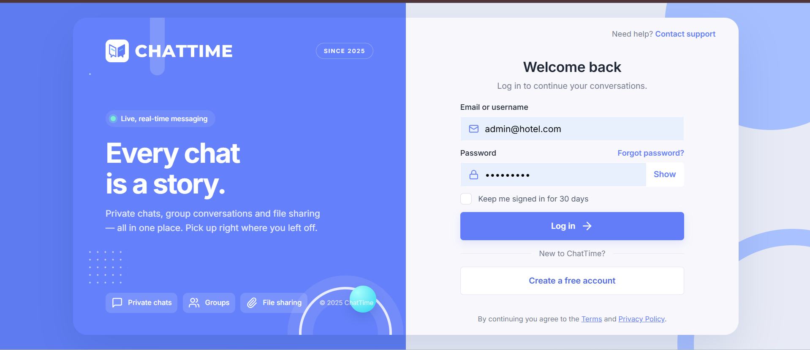

<div align="center">

# ChatTime

### Every chat is a story.

Private conversations, lively groups, and shared moments in one place.


[Preview](#preview) · [Features](#features) · [Getting started](#getting-started) · [Commands](#commands) · [Troubleshooting](#troubleshooting)

</div>

---

## Preview



<div align="center">
  <sub>A welcoming start to your next conversation.</sub>
</div>

## About the project

ChatTime is a full-stack messaging website built with **React + Vite**, **Node.js + Express**, **Socket.IO**, and **MySQL 8**. Chat privately, create groups, share files and voice notes, and keep conversations organised with a responsive inbox and an integrated admin panel.

| Stay connected | Share more | Make it yours |
| --- | --- | --- |
| Live messages, typing indicators, and read receipts | Photos, documents, videos, and voice notes | Profile photos, favourites, pinned chats, and notification preferences |

## Features

- **Accounts** — register (with optional photo), log in with "keep me signed in", password strength rules, password reset, change password, see and sign out other devices.
- **Chats** — one-to-one and group conversations, live delivery, typing indicators, online/last-seen, sent/delivered/read ticks, unread counts, replies, edits, deletes, emoji reactions, @mentions, pinned messages, in-chat search, quick replies.
- **Files** — photos, videos, documents and voice notes. Types are checked from the file's actual contents, size limits are set by the admin, and every download checks conversation membership.
- **Groups** — owner/admin/member roles, add/remove members, invite links, group photo and description, leaving hands ownership on automatically.
- **Your inbox** — pin, mute and archive chats, contacts and favourites, blocking, reporting, in-app and desktop notifications.
- **Admin panel** — dashboard, user management (suspend, sign out everywhere, roles), moderation queue for reports, product settings, and an audit log of every admin action. Admins only see content that has been reported to them.
- **Responsive** — three columns on desktop, two on tablets, one panel at a time on phones.

## Folder structure

```text
ChatTime/
├── client/                    # React app (Vite)
│   ├── public/brand/          # Logo files
│   └── src/
│       ├── components/        # Reusable UI: Avatar, Modal, Menu, Toast, Logo…
│       ├── context/           # Auth state
│       ├── hooks/             # Shared hooks (people search)
│       ├── lib/               # API client, socket client, formatting helpers
│       ├── pages/             # Login, register, password reset, info pages
│       ├── features/          # chat, contacts, notifications, settings, admin, shell
│       └── styles/            # Design tokens and page styles
├── server/
│   ├── scripts/create-admin.js
│   └── src/
│       ├── middleware/        # Sessions/auth, upload limits
│       ├── routes/            # REST endpoints
│       ├── services/          # Business rules (messages, conversations, settings…)
│       ├── sockets/           # Socket.IO events and presence
│       ├── utils/             # Validation, files, HTTP helpers
│       ├── migrate.js         # Upgrades older databases on start-up
│       └── server.js
├── database/realtime_chat_schema.sql
└── uploads/                   # Stored files (not committed)
```

## Getting started

Clone the repository, then follow the setup steps below. Commands use PowerShell.

```powershell
git clone https://github.com/aminanoor-ship-it/ChatTime.git
cd ChatTime
```

### Requirements

- Node.js 20 or newer
- MySQL Server 8.x

## 1. Create the database

Open `database/realtime_chat_schema.sql` in MySQL Workbench and run the whole script. It creates the `realtime_chat` schema and all tables.

If you already imported an older copy of the schema, you don't need to re-import it — the server upgrades it automatically on start-up.

## 2. Configure and start the backend

```powershell
cd server
Copy-Item .env.example .env
npm install
```

Edit `server/.env`:

- `DB_USER` / `DB_PASSWORD` — your MySQL login.
- `JWT_SECRET` — a random value of at least 32 characters. Generate one with:
  ```powershell
  node -e "console.log(require('crypto').randomBytes(48).toString('hex'))"
  ```

Then start it:

```powershell
npm run dev
```

You should see `ChatTime backend running at http://localhost:5000`. If MySQL can't be reached, the server says so and exits.

## 3. Start the website

In a second terminal:

```powershell
cd client
npm install
npm run dev
```

Open http://localhost:5173. The Vite dev server forwards `/api` and `/socket.io` to the backend, so everything runs from one address.

To try real-time chat, register two accounts in two different browsers (or a normal and a private window).

## 4. Create the first administrator

1. Set `ADMIN_USERNAME`, `ADMIN_EMAIL`, `ADMIN_DISPLAY_NAME` and `ADMIN_PASSWORD` in `server/.env`. The password needs 12+ characters with upper and lower case, a number and a symbol.
2. From `server/`, run `npm run create-admin`.
3. Log in with that account — **Admin panel** appears in the menu.
4. Remove `ADMIN_PASSWORD` from `.env` afterwards.

Admins can also promote other users from the admin panel. Nobody can become an admin through registration.

## Password reset emails

No email service is connected yet. When someone requests a reset, the link is printed in the **backend terminal** (valid for 30 minutes). Connect an email provider in `server/src/routes/auth.routes.js` before going live.

## Commands

| Where | Command | What it does |
|---|---|---|
| `server/` | `npm run dev` | Start the API with auto-restart |
| `server/` | `npm start` | Start the API |
| `server/` | `npm run create-admin` | Create the first administrator |
| `client/` | `npm run dev` | Start the website |
| `client/` | `npm run build` | Build the website for production |

## How real-time works

REST handles anything that must be saved or loaded (accounts, history, uploads, admin). Socket.IO carries live events: `message:new`, `message:updated`, `message:reactions`, `message:status`, `typing:update`, `presence:update`, `notification:new`, `conversation:refresh`. Every socket event goes through the same membership and permission checks as the REST API, and messages are only broadcast after they are saved. If the connection drops, the app reconnects and loads anything it missed.

## Security notes

- Passwords are hashed with bcrypt; sessions are stored server-side and referenced from an HttpOnly cookie, so logging out, password changes and suspensions take effect immediately.
- All SQL uses parameterised queries. Uploads are validated by content, stored under random names outside the web root, and served only to members.
- Rate limits protect login, registration, password reset, uploads and reports.
- Before production: serve over HTTPS (set `NODE_ENV=production` for secure cookies), set `CLIENT_ORIGIN` to your real domain, use a dedicated MySQL user instead of `root`, and set up backups.

## Troubleshooting

- **"Could not connect to MySQL"** — check MySQL is running and the `DB_*` values in `server/.env`.
- **"Set JWT_SECRET…"** — generate a secret as shown above.
- **Website loads but says "Cannot reach the ChatTime server"** — the backend isn't running on port 5000.
- **"An Application Control policy has blocked this file" (rollup)** — this Windows policy blocks Rollup's native module. `client/package.json` already switches Rollup to its WebAssembly build via `overrides`; if you see the error, delete `client/node_modules` and `client/package-lock.json` and run `npm install` again.
